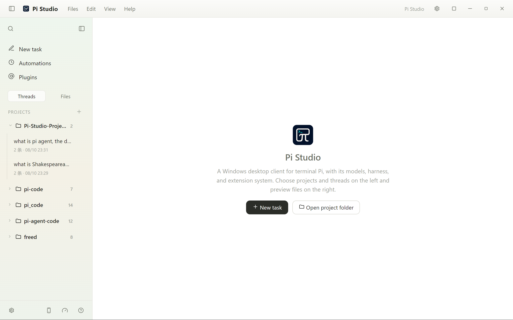
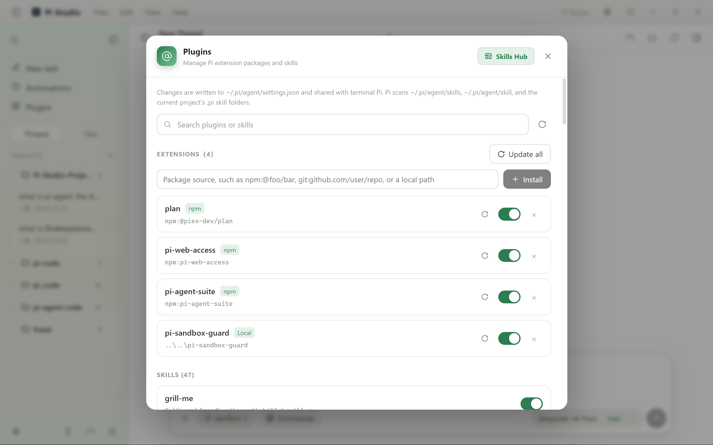
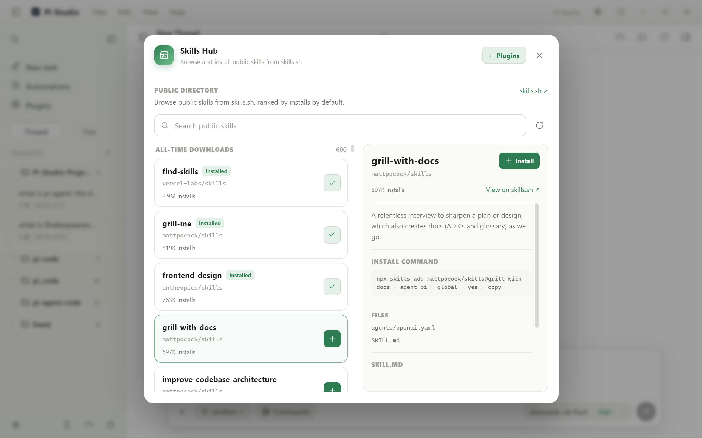
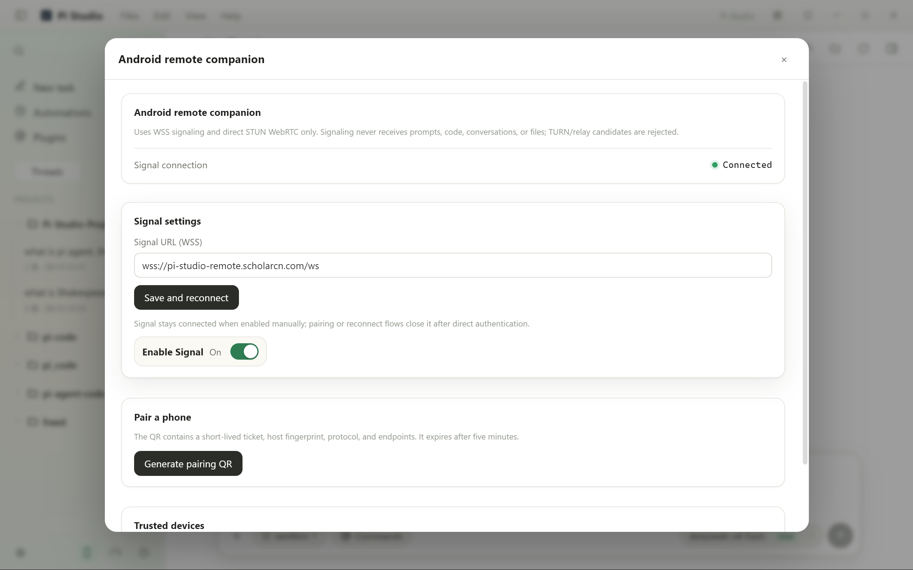

# Pi Studio

最终文件交付参考 DeepSeek Harness 的明确声明方式：Agent 使用 `pi_studio_present` 指定最终产物，同一轮最后一次成功声明覆盖前面的列表。回复完成后在下方显示已校验的文件；中间脚本、临时数据和检查产物不再因被写入而自动展示。声明随会话保存；旧会话仅展示最终回复明确引用的本轮成功产物。

设置中的 **Token usage** 支持按供应商/模型展开费用详情，分别计算输入、输出、缓存读取和写入费用，并展示费用来源、价格目录和自定义 USD/百万 Token 价格。内置目录基于 dsh-cost-meter 的 2026-09-30 快照，支持长上下文及 DeepSeek 历史峰谷档位。已有正值会话费用优先保留；自定义价格可覆盖并重新计算历史范围。订阅等值费用与 API 估算费用分开，未知价格明确标注。主页面左下角 Usage 显示滚动最近 24 小时用量。

同页支持 OpenCode Go、Kimi Code、MiniMax Token Plan、GLM Coding Plan 和 Claude Pro/Max 的周期额度、已用/剩余比例和重置时间；接口提供绝对额度时一并展示。凭据从已配置的官方供应商路由、Pi 登录、环境变量或 OpenCode 登录中发现，不执行凭据命令，也不自动续期 OAuth。页面可见时每分钟刷新，失败保留带时间戳的上次成功数据。仅返回百分比的接口不会被推算成 Token 额度；尚未接入的订阅不显示虚构额度。

[English](README.md) · [简体中文](README.zh-CN.md)

Pi Studio 是一个独立的 Electron 桌面客户端，用于运行 [Pi coding agent](https://github.com/earendil-works/pi)。它将 Pi 项目、任务线程、模型配置、扩展、权限控制、自动化任务和文件预览整合到同一个桌面工作区中。

> Pi Studio 是独立的社区项目，与 Pi 维护者没有隶属或官方背书关系。

## 界面预览

当前界面将主工作区、插件管理、公开 Skills Hub 和 Android 远程控制配置整合在同一个桌面客户端中。

<table>
  <tr>
    <td width="50%"></td>
    <td width="50%"></td>
  </tr>
  <tr>
    <td align="center">主页</td>
    <td align="center">插件管理</td>
  </tr>
  <tr>
    <td width="50%"></td>
    <td width="50%"></td>
  </tr>
  <tr>
    <td align="center">Skills Hub</td>
    <td align="center">Android 远程控制配置</td>
  </tr>
</table>

## 新增功能

- **常用供应商快捷配置** —— 设置 → 模型与提供商顶部新增快捷面板，内置 OpenCode Go / Zen、智谱 GLM Coding Plan（中国站 / 国际站）、通义千问 Token 套餐（中国站 / 国际站 / 个人版）、MiniMax Token Plan（中国站 / 国际站）、DeepSeek、Kimi For Coding、Moonshot / Kimi API（中国站 / 国际站）和小米 MiMo Token 套餐。选择供应商后只需粘贴 API Key，API 地址、协议和模型列表都由 Pi 内置目录提供；可先“测试连接”再保存，保存后模型立即出现在模型选择器中。密钥写入 `models.json` 中同名供应商的 `apiKey` 字段，不覆盖 Pi 的端点与内置模型列表，也不会改动 `auth.json`；面板会提示 `auth.json` 中的登录凭据是否优先于该密钥。
- **模型列表一致性** —— 对已明确配置模型列表的供应商，线程模型选择器只显示设置中保存的可用模型，避免混入同名供应商的内置模型；保存后同步刷新已打开线程。
- **Office 文件预览** —— 本地只读的 Univer 表格视图，支持工作表切换、公式栏、缩放，以及常见 XLSX 样式、合并单元格、行高列宽和冻结行列；DOCX 使用分页视图，保留页眉、页脚与表格，支持适应宽度。无需转换服务器，不上传文件。图表、图片、透视表和条件格式尚未完整导入，大文件会明确提示预览范围限制；PPTX 保留现有基础预览。
- **Token 用量热力图** —— 在设置中按今天、近 7 天、近 30 天、近一年或自定义日期查看用量，支持每日、每周、累计视图；绿色色阶跟随界面主题。包含输入、输出、缓存、模型用量与估算费用，并对分支复制记录去重。
- **MCP 市场（Glama）** —— 设置 → MCP 中新增市场面板，数据来自 [Glama MCP 目录](https://glama.ai/mcp/servers)。支持关键词搜索、按分类/语言/托管方式筛选，并读取服务器页面上的安装示例填入启动命令、参数和环境变量；安装前可编辑、查看生成的 `mcp.json` 条目，重名需显式确认覆盖。安装直接写入 Pi 共享的 `mcp.json`，成功后运行 `/reload` 即可加载工具。面板遵守 Glama 的数据署名要求，显示来源链接，并为每条记录提供回链。左侧栏“插件”下方新增“MCP 市场”快捷入口，点击直接打开该页。
- **Pi Agent 1.3.0 与 MCP** —— 内置官方 MCP、Codemode 和工具搜索。在设置 → MCP 中添加或编辑 `mcpServers` JSON、启停或移除服务器、检查连接与工具，以及执行 OAuth 登录/退出。支持 stdio 与 Streamable HTTP；保存后在聊天中执行 `/reload` 或重新打开聊天。聊天支持嵌套工具调用记录、扩展状态与文本组件。
- **插件管理** —— 支持搜索、安装、更新、启用、停用和删除来自 npm、GitHub 或本地路径的 Pi extension 包；同一面板也会列出 Pi 共享目录和当前项目中发现的 skill。
- **Skills Hub** —— 浏览和搜索公开的 [skills.sh](https://skills.sh/) 目录，查看 skill 详情与安装命令，并直接安装到 Pi。
- **Android 手机远程控制** —— 通过短时有效的二维码与桌面端配对，配置 Signal WSS 地址，查看连接状态并管理可信设备。远程传输使用带 STUN 发现的直连 WebRTC，并有意拒绝 TURN/relay 候选；针对 Pi-Studio-Remote 0.2，项目相对路径预览还支持受限的 Excel/CSV 表格快照。
- **中英文界面** —— 桌面端支持在 English 和简体中文之间切换。

## 功能

- 在桌面侧边栏管理本地项目和 Pi 任务线程。
- 使用流式响应聊天，并配置模型与思考级别。
- 阅读和预览 Markdown、HTML、源代码、图片及常见办公文档。
- 通过 Pi 共享的 `models.json` 配置 provider 和模型。
- 用快捷配置为内置供应商（OpenCode Go/Zen、智谱、MiniMax、千问、DeepSeek、Kimi、Moonshot、小米 MiMo）粘贴 API Key 即可启用。
- 使用 Pi 共享 agent 目录中的扩展和插件。
- 通过内置 Skills Hub 浏览和安装公开 skill。
- 连接 Android companion，远程查看任务线程并执行经过批准的控制操作。
- 运行定时自动化任务，并明确选择 Sandbox 或完全权限。
- 在每个安装包中嵌入版本化的 Pi/Node 运行时，并支持由应用管理运行时更新。
- 使用权限门控制 shell 命令、项目边界和扩展操作。

## 下载

从 GitHub Releases 下载最新的 `Pi-Studio-Setup-<version>.exe`（Windows x64）或 `Pi-Studio-<version>-arm64.dmg`（Apple Silicon macOS）。当前安装包尚未签名，Windows SmartScreen 或 macOS Gatekeeper 可能会显示安全提示。

每个安装包都包含原生的固定版本 Node.js + Pi 运行时。首次启动时，Pi Studio 会校验并将内置运行时解压到用户数据目录；应用更新会自动启用较新的内置运行时，复用相同或更新的已安装版本，不需要另行下载运行时。

## 开发环境要求

- 支持的安装包目标平台是 Windows x64 和 macOS arm64。
- 开发和打包需要 Node.js `24.14.0` 或更高版本，但必须处于 Node 24 主版本内。
- npm。
- 安装项目内独立的 Pi coding agent 运行时（开发和打包均可使用）：

```powershell
npm install --global --prefix .runtime-source @earendil-works/pi-coding-agent@1.3.0
```

## 开发

```powershell
npm install
npm run typecheck
npm run test:permission
npm run dev
```

常用命令：

```powershell
npm run build             # 构建 Electron 应用
npm run bundle            # 构建由安装包嵌入的运行时归档
npm run dist              # 打包、构建并创建安装包
npm run pack              # 创建未打包的目录构建产物
```

构建产物写入 `release/`。`npm run dist` 会创建包含内置运行时归档的 Electron 安装包；`release/` 中生成的归档会保留用于 QA，不需要单独上传。仓库在 `package.json` 中固定 Pi 运行时版本 `1.3.0`，打包脚本会在创建归档前校验该版本，优先使用 `.runtime-source` 中的安装，也兼容匹配版本的全局 Pi。如需从指定的本地安装位置打包，可将 `PI_PACKAGE_DIR` 设置为对应的 package 目录。

新增功能验证：`npm run test:usage-mcp`、`npm run test:settings-ui`。执行 `npm run bundle` 后可运行 `npm run test:runtime-mcp`，它使用隔离配置和本地模拟 MCP/模型服务检查打包运行时升级与真实嵌套调用，不使用用户凭据。

## 配置与数据

Pi Studio 使用 Pi 的 agent 配置目录 `~/.pi/agent`，其中包括模型、provider、身份验证和扩展设置。桌面应用自己的设置保存在 Electron 用户数据目录中。

API key 属于用户数据。不要将 `auth.json`、`models.json`、会话文件、包含 key 的截图或本地配置目录提交到仓库。

## 权限与安全

Pi 可以代表用户读写项目文件并执行工具。Pi Studio 默认以 Sandbox 模式启动新线程；必须明确选择后才能使用完全权限。上述控制可以减少误操作，但不能替代操作系统隔离或用户审核。

不要在公开 issue、pull request、截图或示例文件中粘贴 API key 或其他密钥。如发现安全问题，请先通过 GitHub 私下联系项目维护者，再进行公开披露。

## 参与贡献

欢迎提交 bug 报告和 pull request。提交修改前请：

1. 保持修改范围集中，并说明面向用户的行为变化。
2. 运行 `npm run typecheck`。
3. 如果修改了权限或工具执行代码，运行 `npm run test:permission`。
4. 不要包含本地数据、生成的 bundle、安装包、凭据或 QA 浏览器配置文件。

## 第三方软件

Pi Studio 使用 Electron、React、Vite、Pi coding agent、Node.js 以及其他开源依赖。组件清单和许可证信息请参见 [THIRD_PARTY_NOTICES.md](THIRD_PARTY_NOTICES.md)。

## 许可证

Pi Studio 源代码使用 [MIT License](LICENSE) 授权。

Pi 名称、项目名称、logo 及其他商标仍归其各自所有者所有。MIT 许可证不授予商标使用权。
